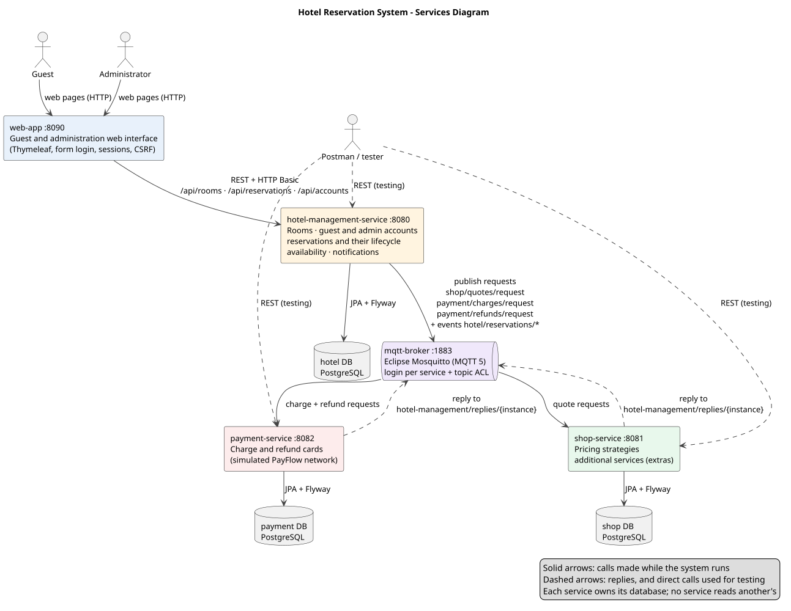

# Hotel Management and Reservation System — Java Proof of Concept

A guest and administration web app in front of three Spring Boot microservices
(hotel management, shop, payment). Each service is built with clean architecture and owns its
own PostgreSQL database. The services talk to each other over **MQTT** (a Mosquitto broker);
each also keeps a REST API for the web app and for testing.



All diagrams (services, clean architecture, booking sequence, MQTT topics, deployment, code
split) are in [diagrams/](diagrams/README.md). The code demonstrates six design patterns from the UML design:
Strategy, Decorator, State, Observer, Adapter, and Facade.

## Quick start

From the repository root (Linux, macOS or WSL), with Docker running:

```bash
./scripts/generate-secrets.sh
```

```bash
docker compose up --build -d
```

Open **http://localhost:8090**. Register as a guest to book, or log in as `admin` with the
password in `secrets/admin_password.txt`.

## Requirements
- **Docker** (Engine 20.10+ or Docker Desktop) with **Compose v2** (`docker compose version`).
  Nothing else is needed to run the system; the images build the code themselves.
- Free ports **8080, 8081, 8082, 8090 and 1883** on the host.
- Optional, to build and test outside Docker: JDK 21 and Maven 3.9 (IntelliJ's bundled Maven works).
- Optional, to test the APIs: [Postman](https://www.postman.com/downloads/) (see "Testing with Postman").

## Run with Docker Compose

1. **Create the passwords** (once). This writes random passwords for the APIs, the three
   databases, the MQTT broker logins and the admin account to `secrets/`, which is git-ignored.
   Run it again after pulling new code: it adds any new passwords and keeps the existing ones.

   ```bash
   ./scripts/generate-secrets.sh
   ```

2. **Build the images and start all eight containers** (three databases, the MQTT broker, three
   services, the web app). The first build downloads Maven dependencies and takes a few minutes; later builds are
   quick:

   ```bash
   docker compose up --build -d
   ```

3. **Check that everything is up.** All containers should be `running`, and the databases and
   the broker `healthy` (services wait for their database and the broker before starting):

   ```bash
   docker compose ps
   ```

4. **Open the web app** at **http://localhost:8090**.

5. **Watch the logs** (booking events, payments, notifications) if you like:

   ```bash
   docker compose logs -f hotel-management-service payment-service
   ```

   or the reservation events going over MQTT (`confirmed`, `cancelled`, `checked-in`, `checked-out`):

   ```bash
   docker compose exec mqtt-broker sh -c 'mosquitto_sub -V 5 -u hotel-management -P "$(cat /run/secrets/mqtt_hotel_password)" -t "hotel/reservations/#" -v'
   ```

6. **Stop** everything (data is kept in Docker volumes):

   ```bash
   docker compose down
   ```

   To also delete all data and start from empty databases, use `docker compose down -v`.

**Troubleshooting**
- `Cannot connect to the Docker daemon`: start Docker (`sudo systemctl start docker` on Linux, or
  open Docker Desktop).
- `port is already allocated`: another program uses 8080–8082, 8090 or 1883 (often a local
  Mosquitto); stop it, or change the
  left-hand port in `docker-compose.yml` (for example `"9090:8090"`).
- `secrets/... not found` or a service exits saying a password is empty: run
  `./scripts/generate-secrets.sh` again (existing passwords are kept).
- A booking or quote fails after about 10 seconds with `No reply on MQTT topic ...` in the hotel
  management logs: the shop or payment service is not running or not connected to the broker
  (`docker compose ps`, then `docker compose logs shop-service payment-service mqtt-broker`).
- After changing a database password you must also run `docker compose down -v`, because
  PostgreSQL only reads its password when the database is first created.

- **Guests** search availability by dates, then (after logging in or registering) pick a room,
  add extras, review the price and pay by card. They can cancel a confirmed reservation from
  "My reservations" and get a refund.
- **Administrators** are pre-created in the hotel database at startup. Log in as `admin` with the
  password in `secrets/admin_password.txt` to see every reservation and room, and to check guests
  in and out.

| Container | Port | Purpose |
|---|---|---|
| `web-app` | 8090 | Guest and administration web interface |
| `hotel-management-service` | 8080 | Rooms, accounts, reservations (REST API for the web app) |
| `shop-service` | 8081 | Pricing and additional services (answers MQTT quote requests; REST API for testing) |
| `payment-service` | 8082 | Payments (answers MQTT charge and refund requests; REST API for testing) |
| `mqtt-broker` | 1883 | Eclipse Mosquitto MQTT 5 broker for the service-to-service messages |
| `hotel-db`, `shop-db`, `payment-db` | not published | One PostgreSQL database per service |

## Service-to-service messaging (MQTT)

The web app calls the hotel management service over HTTP. The hotel management service reaches the
shop and payment services **only through the MQTT broker**, using MQTT 5 request/response: every
request names a reply topic and a correlation id, and the answer comes back on that topic with
the same id. The booking flow therefore stays immediate: the guest sees approved or declined at once.

| Topic | Published by | Answered by | Message |
|---|---|---|---|
| `shop/quotes/request` | hotel management | shop | Nightly rate, nights and extras → total and breakdown |
| `payment/charges/request` | hotel management | payment | Reservation, amount and card → `APPROVED` or `DECLINED` with reason |
| `payment/refunds/request` | hotel management | payment | Transaction id → `REFUNDED` |
| `hotel-management/replies/{instance}` | shop, payment | (the waiting request) | `{"status": "OK", "body": ...}`, or `INVALID_REQUEST` / `NOT_FOUND` / `REJECTED` / `ERROR` with `error` |
| `hotel/reservations/{event}` | hotel management | anyone interested | Reservation event (`confirmed`, `cancelled`, `checked-in`, `checked-out`); no card or contact details |

- **Logins and permissions:** each service has its own broker login (a Docker secret), and the
  broker's ACL ([mqtt-broker/acl](mqtt-broker/acl)) allows each one only its own topics. For
  example, only hotel management may ask for a charge, and only payment may read charge requests.
- **Scaling:** shop and payment subscribe with shared subscriptions (`$share/shop-service/...`),
  so running several copies spreads the requests between them, and each request is handled once.
- **Failures:** if no reply arrives within 10 seconds (`MQTT_REQUEST_TIMEOUT`), the request fails
  and a booking is released, never left holding the room. Services start even when the broker is
  not up yet and keep reconnecting; subscriptions are restored after every reconnect. A failed
  reservation event is logged and never fails the booking.

Data is kept in Docker volumes. To start from empty databases: `docker compose down -v`.

## Testing with Postman

The `postman/` folder has a collection covering every feature (58 requests with test scripts,
113 assertions):

| Folder | Covers |
|---|---|
| 0. Setup | Picks fresh dates and usernames, so the collection can be run again and again |
| 1. Accounts | Register (and duplicate / invalid), authenticate guest, wrong password, pre-created admin |
| 2. Rooms and availability | Room list, availability by dates, past dates and stays over 30 nights refused |
| 3. Booking and payment | Price quote, booking with a card, overlap refused, back-to-back stays, declined card (402), unknown guest, guest and admin lists, check-in, check-out |
| 4. Cancellation and refunds | Guest cancels own booking (refund, dates freed), other guest refused, admin cancels |
| 5. Shop service | Quotes with extras and the seasonal strategy, invalid request |
| 6. Payment service | Every test card, Luhn and expiry checks, masked card, refunds |
| 7. Security | Missing or wrong credentials, one service's credentials refused by another |
| 8. Web app | Public pages, login required for booking and administration, CSRF-protected login form |

1. Start the system (see above).
2. Create an environment file with your passwords filled in (it is git-ignored):

   ```bash
   ./scripts/make-postman-env.sh
   ```

3. In Postman: **Import** `postman/hotel-reservation.postman_collection.json` and
   `postman/hotel-reservation-local.with-secrets.postman_environment.json`, select the
   environment **Hotel reservation (local) + secrets**, then run the collection with the
   **Collection Runner** (keep the default order). Every request should be green.
   (Alternatively import `postman/hotel-reservation-local.postman_environment.json` and paste the
   four passwords from `secrets/*.txt` into it.)

The same collection runs from the command line with Postman's CLI runner, Newman:

```bash
npx newman run postman/hotel-reservation.postman_collection.json -e postman/hotel-reservation-local.with-secrets.postman_environment.json
```

The full guest and admin click-through (forms with CSRF tokens) is best done in a browser at
http://localhost:8090.

## Run without Docker

```bash
mvn package
```

Start each jar with its passwords in the environment; each service also needs a PostgreSQL
database (see the `*_DB_URL` settings in each `application.yml`), and the three backend services
need the MQTT broker, which you can run alone from this project:

```bash
docker compose up -d mqtt-broker
```

```bash
shop_api_password=$(cat secrets/shop_api_password.txt) shop_db_password=$(cat secrets/shop_db_password.txt) mqtt_shop_password=$(cat secrets/mqtt_shop_password.txt) java -jar shop-service/target/shop-service.jar
```

## Booking, availability and payments

**Booking flow (web app):** search dates → only free rooms are listed → choose a room (log in
or register if needed, then you come back to it) → pick extras → review the shop's price
breakdown → pay by card → confirmation. A declined card brings you back to the review page with
the reason, and nothing is booked.

**No overlapping bookings:**
- Dates are checked first: no check-in in the past, check-out after check-in, at most 30 nights.
- Availability is date-based: a room is taken for a night only by a reservation that holds it
  (pending while being paid, confirmed, or checked in). Cancelled and completed stays free their
  nights.
- The hotel database has a `room_nights` table with one row per room per night and a primary key
  on (room, night). A reservation that holds a room owns those rows, so the database itself
  rejects a second booking of the same night, even when two bookings arrive at the same moment.
- The room is held before the card is charged, so a refused booking is never charged.

**Simulated payment system:** the payment service charges cards through a simulated card network
("PayFlow", behind the Adapter). It validates the card (Luhn checksum, expiry, CVC), then the
card number decides the outcome:

| Test card | Result |
|---|---|
| `4242 4242 4242 4242` (or any other valid number) | Approved |
| `4000 0000 0000 0002` | Declined |
| `4000 0000 0000 9995` | Insufficient funds |
| `4000 0000 0000 0069` | Expired card |

Use any future expiry date and any 3-digit CVC. Only the card brand and last four digits are
stored; card numbers and CVCs are never written to a database or a log. Cancelling a confirmed
reservation refunds its payment.

## Security
- **Web app:** form login with sessions and CSRF protection. Booking pages need the `GUEST` role,
  administration pages need `ADMIN`. The web app checks usernames and passwords with the hotel
  management service and books under the signed-in guest's account, never an id from the form.
- **Accounts:** guests register through the web app; passwords are stored as bcrypt hashes. The
  administrator is created (or its password updated) from the `admin_password` secret when the
  hotel management service starts. The service also refuses bookings for unknown guest accounts.
- **Service APIs:** every REST API needs HTTP Basic credentials. The web app holds the hotel
  management password. The shop and payment passwords are only for direct calls (Postman,
  debugging); the services themselves talk over MQTT.
- **MQTT:** the broker refuses anonymous clients. Each service logs in with its own password and
  the ACL limits it to its own topics (see "Service-to-service messaging").
- **Secrets:** every password (APIs, databases, broker logins, admin) is a Docker secret mounted
  at `/run/secrets/<name>` and read by Spring through `configtree:`; the broker turns its three
  into a hashed password file at startup. Each container gets only the secrets it needs. Services
  refuse to start without their API and broker passwords.
- To rotate a password: delete its file in `secrets/`, run `./scripts/generate-secrets.sh`,
  then `docker compose up -d --force-recreate`. (Database passwords are set when a database is
  first created; rotating one also needs `docker compose down -v`, which deletes the data.)

## Service APIs

All routes need HTTP Basic credentials (`401` without them).

| Route | Success | Errors |
|---|---|---|
| `GET /api/rooms` (hotel) | `200` rooms with status | |
| `GET /api/rooms/available?checkIn=&checkOut=` (hotel) | `200` rooms free for every night | `400` invalid dates |
| `GET /api/reservations[?guestId=]` (hotel) | `200` all reservations, or one guest's | |
| `POST /api/reservations/quote` (hotel) | `200` total and breakdown for a free room | `400` invalid dates, `404` unknown room, `409` room taken |
| `POST /api/reservations` (hotel, with card) | `201` confirmed reservation with payment reference | `400` invalid, `402` card declined, `404` unknown guest or room, `409` room booked for those dates |
| `POST /api/reservations/{id}/cancel` | `200` cancelled and refunded | `404` unknown (or another guest's), `409` wrong state |
| `POST /api/reservations/{id}/check-in` | `200` reservation | `404` unknown, `409` wrong state |
| `POST /api/reservations/{id}/check-out` | `200` reservation | `404` unknown, `409` wrong state |
| `POST /api/accounts` (hotel) | `201` guest account | `400` invalid, `409` username taken |
| `POST /api/accounts/authenticate` (hotel) | `200` account with role | `401` wrong username or password |
| `POST /api/shop/quotes` (shop) | `200` total, currency, breakdown | `400` invalid |
| `POST /api/payments` (payment, with card) | `200` status `APPROVED` or `DECLINED` with reason | `400` invalid |
| `POST /api/payments/{transactionId}/refund` | `200` status `REFUNDED` | `404` unknown, `409` not refundable |

## Tests

```bash
mvn verify
```

The same command runs on every push and pull request to `main` (`.github/workflows/tests.yml`).
Tests use an in-memory H2 database in PostgreSQL mode with the real Flyway migrations, so no
Docker is needed.

| Test | Covers |
|---|---|
| Use-case tests (`ReservationUseCasesTest`, `AccountUseCasesTest`, `QuoteStayInteractorTest`, `ProcessPaymentInteractorTest`) | Business rules, with recording presenters and in-memory or stub gateways |
| API tests (`ReservationApiTest`, `ShopApiTest`, `PaymentApiTest`) | Routes, status codes and auth, through Spring and the database |
| `PersistenceAdaptersTest` | The JPA gateway adapters against the real schema, including the database refusing two holds on the same night |
| `PaymentCardTest` | Card validation (Luhn, expiry, CVC), brands, and that card numbers are never printed |
| `MqttMessagingTest` | The MQTT messages hotel management sends to shop and payment (topics, reply topic, correlation id, body), reply handling, timeouts, reservation events |
| `ShopMqttApiTest`, `PaymentMqttApiTest` | The shop and payment services answering MQTT requests, through Spring and the database, with an in-memory broker |
| `WebAppSecurityTest` | Pages, role rules, CSRF, login and registration in the web app |
| `ArchitectureTest` (every module) | Layer rules, no imports between services, no frameworks in the core layers |

## Project layout

| Module | Business purpose | Database |
|---|---|---|
| `web-app` | Guest and administration web interface | none |
| `hotel-management-service` | Rooms, guest and admin accounts, reservations and their lifecycle, notifications | `hotel` |
| `shop-service` | Pricing strategies and the additional services price list | `shop` |
| `payment-service` | Charging the guest and recording every payment | `payment` |

Each service is organised with clean architecture (`controller`, `presenter`, `model`, `usecase`,
`entity`, `gateway`, `infrastructure`, `config`); the database is one more adapter in
`infrastructure`. See [docs/architecture.md](docs/architecture.md) for the rules and
[diagrams/](diagrams/README.md) for the diagrams.

## What is intentionally simplified
- The payment gateway is simulated; no real payment is taken.
- Three rooms are seeded by a database migration; there is no room administration yet.
- Auth between containers is HTTP Basic over plain HTTP, and MQTT runs over plain TCP; use HTTPS
  and MQTT over TLS (port 8883) for anything real.
- Requests sent while the shop or payment service is down are not queued; the caller times out.
  If a charge reply is lost after the card was charged, the booking is released but the charge
  stays; it shows up in the payment database for a manual refund.
- Web sessions are kept in memory, so restarting the web app logs everyone out.

## Pattern map
| Pattern | Service | Main implementation |
|---|---|---|
| Strategy | shop | `PricingStrategy`, `StandardPricing`, `SeasonalPricing`, `LongStayDiscountPricing` |
| Decorator | shop | `Chargeable`, `RoomStayCharge`, `ServiceDecorator`, service decorators |
| State | hotel management | `ReservationState` and concrete reservation states (also decides which states hold a room) |
| Observer | hotel management | `ReservationObserver`, `ReservationEventPublisher`, notifier classes, `MqttReservationEventPublisher` |
| Adapter | payment | `PaymentProcessor`, `PayFlowGatewayAdapter`, `PayFlowGateway` |
| Facade | hotel management | `FrontDeskController` |

## Try changing the demo
- In `shop-service/.../config/ShopConfig.java`, replace `SeasonalPricing` with `StandardPricing` or `LongStayDiscountPricing`.
- Tick or untick breakfast, spa or airport transfer when booking to add/remove `BreakfastService`, `SpaPackage`, or `AirportTransfer`.
- Change a price in the shop database's `extra_prices` table and book again.
- Pay with `4000 0000 0000 9995` to see a declined card, then with `4242 4242 4242 4242`.
- Book a room, then search overlapping dates: the room is no longer listed.
# asd-hotel-reservation-nonaislop
