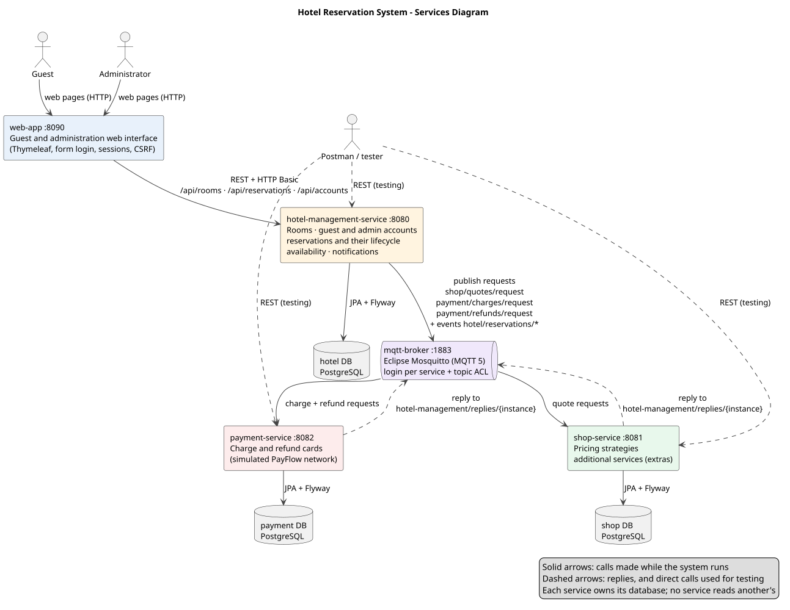
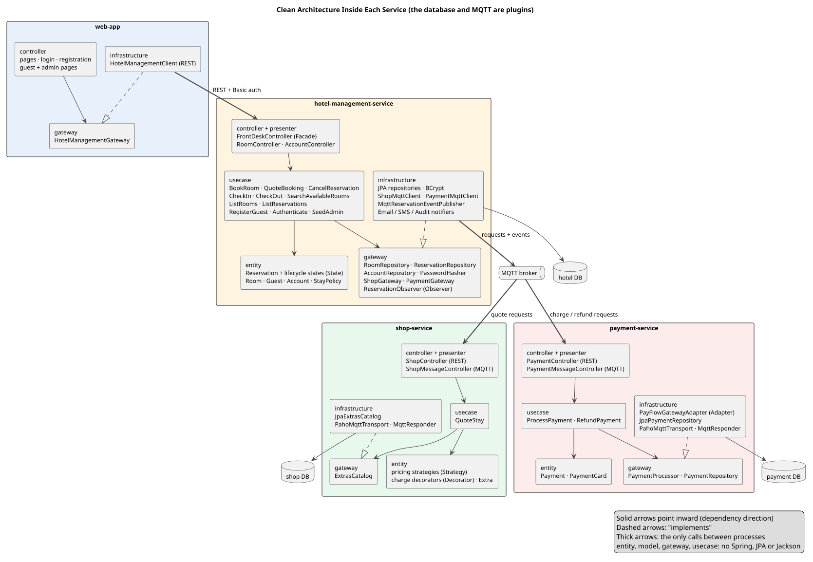
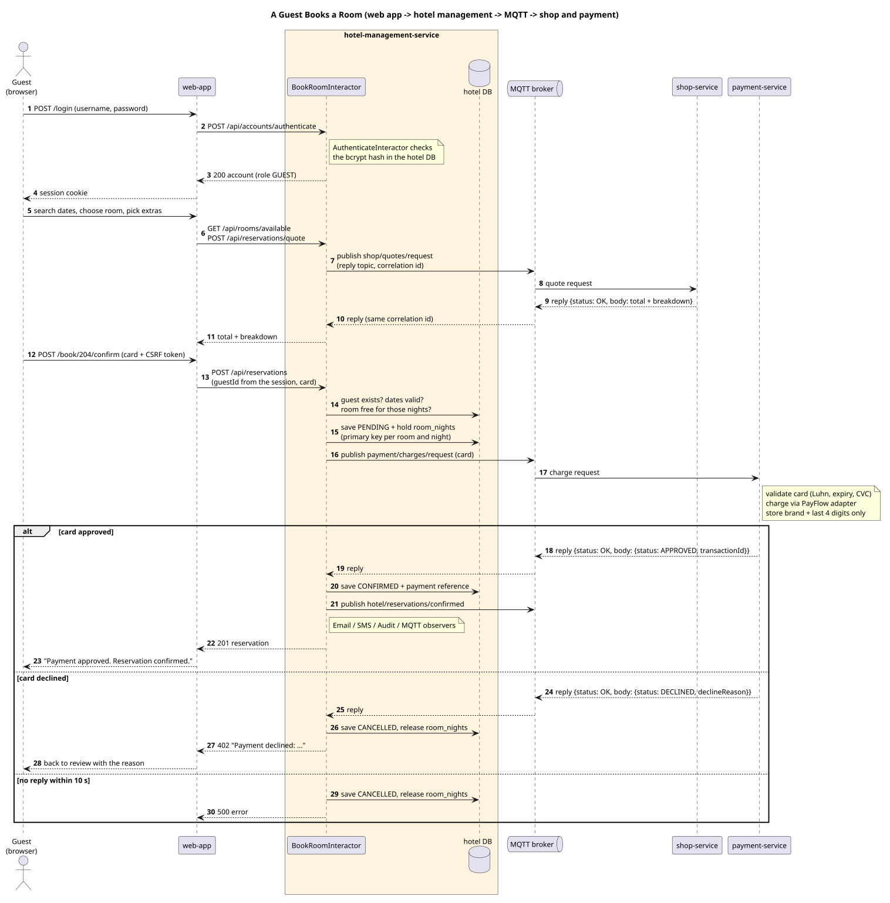
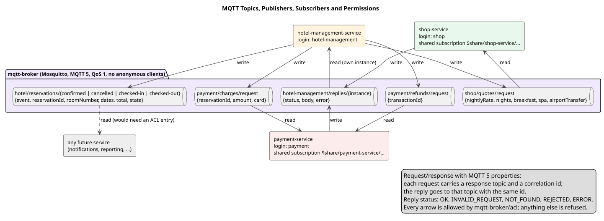
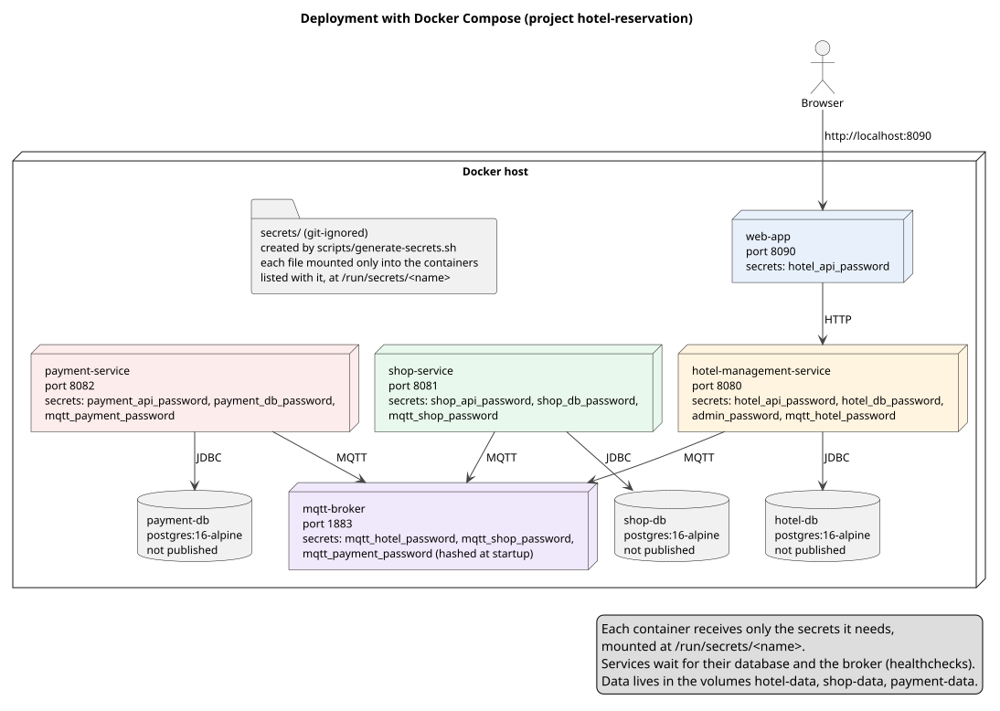
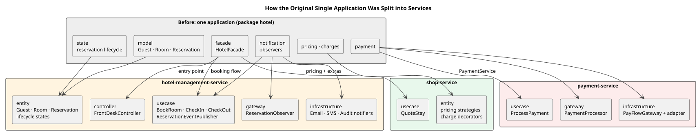

# Diagrams

Architecture diagrams of the hotel reservation microservices. Each diagram has its PlantUML
source (`.puml`) and a rendered image (`.svg`), the same way as the `req3` and `req4` folders.
The written explanation is in [docs/architecture.md](../docs/architecture.md).

| Diagram | Shows |
|---|---|
| [Services](#services) | The services, what each one does, and how they talk (HTTP and MQTT) |
| [Clean architecture](#clean-architecture-inside-each-service) | The layers inside each service; the database and MQTT as plugins |
| [Booking sequence](#a-guest-books-a-room) | A guest logs in, gets a quote and books, with approved, declined and timeout paths |
| [MQTT messaging](#mqtt-topics-and-permissions) | Every topic, who writes and reads it, and the broker's permissions |
| [Deployment](#deployment-with-docker-compose) | The Docker Compose containers, ports and secrets |
| [Code split](#how-the-original-code-was-split) | Where each package of the original single application went |

## Services



## Clean architecture inside each service



## A guest books a room



## MQTT topics and permissions



## Deployment with Docker Compose



## How the original code was split



## Regenerating the images

After editing a `.puml` file, render it again with [PlantUML](https://plantuml.com/) (no
Graphviz needed, the diagrams use PlantUML's built-in layout):

```bash
plantuml -tsvg diagrams/*.puml
```
