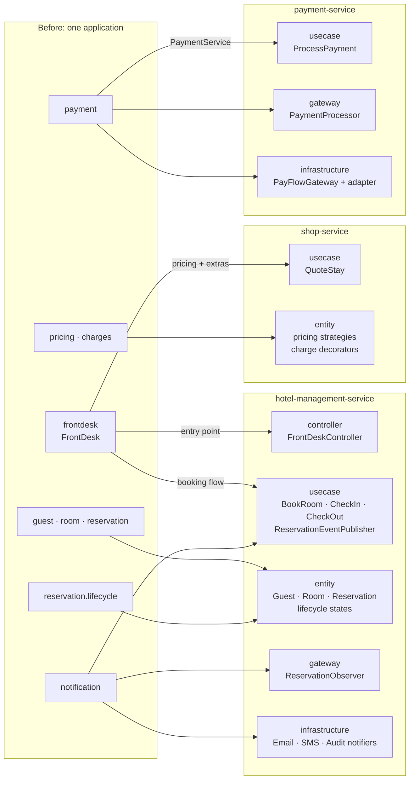
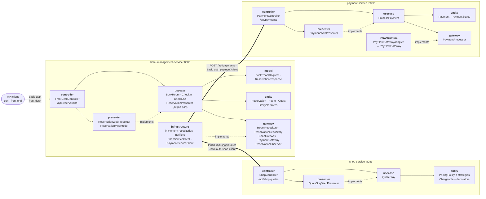
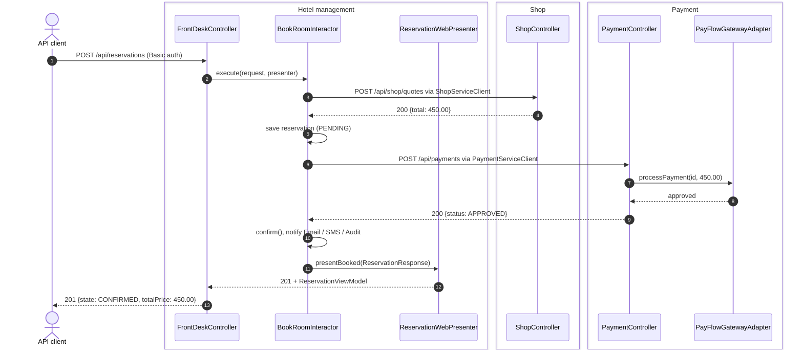
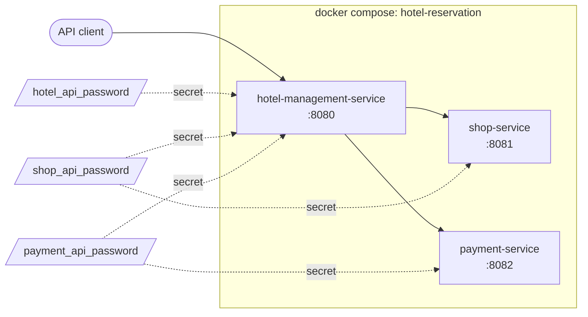

# Architecture: three Spring Boot services, clean architecture inside each

The system is split into three services by business purpose. Each service is its own Maven
module, Spring Boot application and Docker container. A service talks to another one only over
HTTP, through that service's REST controller, with HTTP Basic auth.

| Service (module) | Business purpose | Entry point | Port |
|---|---|---|---|
| `hotel-management-service` | Rooms, guests, reservations and their lifecycle, guest notifications | `FrontDeskController` → `/api/reservations` | 8080 |
| `shop-service` | Pricing strategies and additional services (breakfast, spa, airport transfer) | `ShopController` → `/api/shop/quotes` | 8081 |
| `payment-service` | Charging the guest through an external payment provider | `PaymentController` → `/api/payments` | 8082 |

Layers inside each service:

| Layer | Holds | May depend on |
|---|---|---|
| `controller` | REST endpoints; creates a presenter per request and calls a use case | `usecase`, `model`, `presenter` |
| `presenter` | Implements the use case's output port; builds the JSON view model and HTTP status | `usecase`, `model` |
| `model` | Request/response records crossing the use case boundary | `entity` (only to build responses) |
| `usecase` | One interface per use case, its implementation (interactor), and its presenter interface (output port) | `entity`, `model`, `gateway` |
| `entity` | Core business objects and rules | nothing outside `entity` |
| `gateway` | Interfaces for what the use cases need from outside | `entity` |
| `infrastructure` | Gateway implementations: storage, external SDKs, HTTP clients of other services | `gateway`, `entity`, `model` |
| `config` | Spring wiring (composition root) and security | everything in the service |

`entity`, `model`, `gateway` and `usecase` contain no Spring code. The shop needs nothing from
outside, so it has no `gateway` or `infrastructure` layer. Every rule here is enforced by the
`ArchitectureTest` in each module.

## 1. How the original code was split

Each package of the original single application went to one service; the old `FrontDesk`
was split between hotel management (orchestration) and the shop (pricing and extras).

## 2. Inside the services and how they talk

Solid arrows point in the direction of a dependency (inward, toward the entities). Dashed arrows
mean "implements". The thick arrows are the only calls between services: HTTP with Basic auth.

## 3. A booking across the three services

## 4. Deployment with Docker Compose

Each service runs in its own container. Each container gets only the secrets it needs; the
hotel management service also holds the passwords of the services it calls.

## Rules that keep the services independent

1. **Dependencies point inward.** `controller → usecase → entity`. Use cases reach the outside
   world only through `gateway` interfaces and send results out only through their presenter
   interface.
2. **Entities never leave a service.** Use cases hand `model` records to presenters, and
   presenters turn them into view models for JSON.
3. **No shared code between services.** Each service is a separate module. The hotel management
   clients keep their own copy of the shop and payment request/response shapes.
4. **Every call is authenticated.** Each API requires HTTP Basic auth; passwords are Docker
   secrets, never committed.
5. **`config` is the composition root.** It is the only place that knows every concrete class.

## Where every original class went

| Before | After |
|---|---|
| `frontdesk.FrontDesk` | Split: `FrontDeskController` + `BookRoom`, `CheckIn`, `CheckOut` use cases in hotel management; the pricing and extras part moved to the shop's `QuoteStayInteractor` |
| `guest.Guest`, `room.Room`, `room.RoomStatus`, `reservation.Reservation` | `hotelmanagement.entity` |
| `reservation.lifecycle.*` | `hotelmanagement.entity.lifecycle` |
| `room.RoomAvailabilityService` | `Room.isAvailable()` |
| `room.RoomService` | Room status updates inside `CheckInInteractor` / `CheckOutInteractor` |
| `reservation.ReservationService` | Id sequence in `InMemoryReservationRepository.nextId()` |
| `notification.ReservationObserver` | `hotelmanagement.gateway` |
| `notification.ReservationEventPublisher` | `hotelmanagement.usecase` |
| `notification.EmailNotifier`, `SmsNotifier`, `AuditLogObserver` | `hotelmanagement.infrastructure` |
| `pricing.*` | `shop.entity.pricing` |
| `charges.*` | `shop.entity.charges` |
| `payment.PaymentProcessor` | `payment.gateway` |
| `payment.PayFlowGateway`, `PayFlowGatewayAdapter` | `payment.infrastructure` |
| `payment.PaymentService` | `payment.usecase.ProcessPaymentInteractor` |
