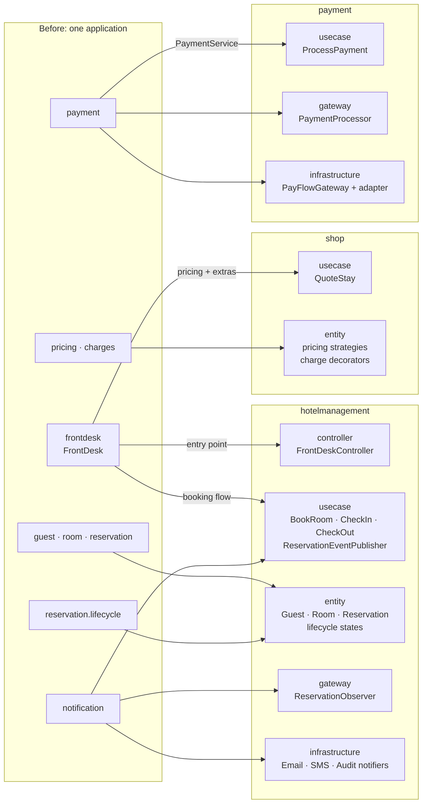
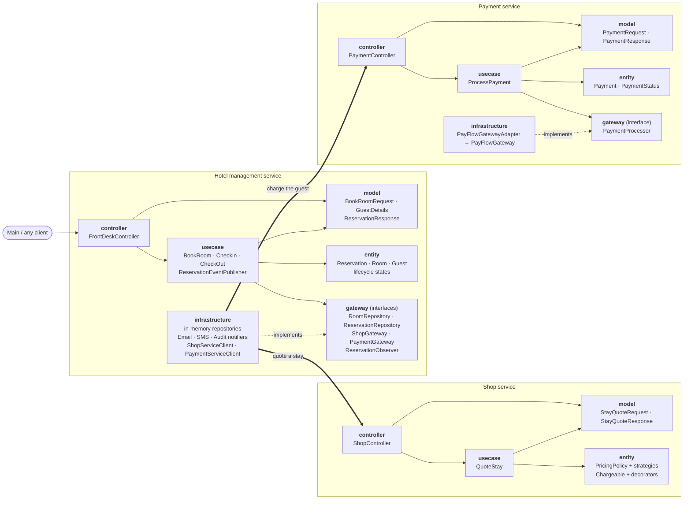
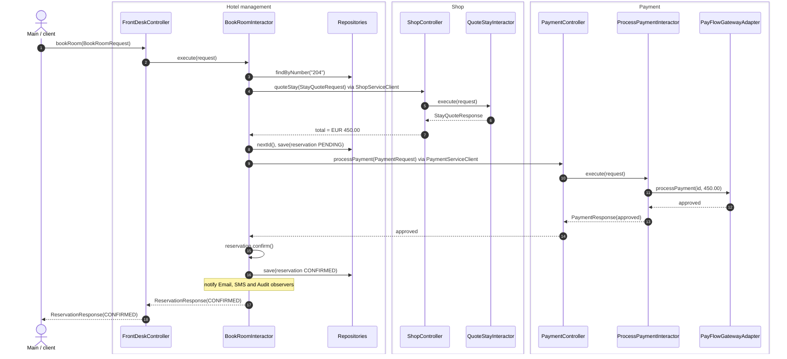

# Architecture: three services, clean architecture inside each

The proof of concept is split into three services by business purpose. Every service is laid
out the same way, and a service talks to another one only through that service's controller.

| Service | Business purpose | Entry point |
|---|---|---|
| `hotelmanagement` | Rooms, guests, reservations and their lifecycle, guest notifications | `FrontDeskController` |
| `shop` | Pricing strategies and additional services (breakfast, spa, airport transfer) | `ShopController` |
| `payment` | Charging the guest through an external payment provider | `PaymentController` |

Layers inside each service:

| Layer | Holds | May depend on |
|---|---|---|
| `controller` | The service's entry point | `usecase`, `model` |
| `model` | Request/response records that cross the controller | `entity` (only to build responses) |
| `usecase` | One interface per use case, plus its implementation (interactor) | `entity`, `model`, `gateway` |
| `entity` | Core business objects and rules | nothing outside `entity` |
| `gateway` | Interfaces for what the use cases need from outside | `entity` |
| `infrastructure` | Implementations of the gateways: storage, external SDKs, clients of other services | `gateway`, `entity`, `model`, and **another service's `controller`/`model` only** |

The shop needs nothing from outside, so it has no `gateway` or `infrastructure` layer.

## 1. How the original code was split

Each package of the original single application went to one service; the old `FrontDesk`
was split between hotel management (orchestration) and the shop (pricing and extras).

## 2. Inside the services and how they talk

Solid arrows point in the direction of a dependency (always inward, toward the entities).
Dashed arrows mean "implements". The thick arrows are the only calls between services.

## 3. A booking across the three services

## Rules that keep the services independent

1. **Dependencies point inward.** `controller → usecase → entity`. Use cases reach the outside
   world only through `gateway` interfaces, and `infrastructure` implements them.
2. **Entities never leave a service.** Controllers take and return `model` records.
3. **One door between services.** A service calls another only from its `infrastructure`
   layer, and only through that service's `controller` and `model`
   (`ShopServiceClient`, `PaymentServiceClient`).
4. **`Main` is the composition root.** It is the only class that knows every concrete class
   and wires the three services together.

Today the services run in one JVM and call each other in-process. To deploy them separately,
each service package becomes its own module with its own `Main`, and the two client classes
switch from calling the controller directly to calling it over HTTP. Rule 3 is what keeps
that change limited to those two classes.

## Where every original class went

| Before | After |
|---|---|
| `frontdesk.FrontDesk` | Split: `hotelmanagement.controller.FrontDeskController` + `BookRoom`, `CheckIn`, `CheckOut` use cases; the pricing and extras part moved to `shop.usecase.QuoteStayInteractor` |
| `guest.Guest`, `room.Room`, `room.RoomStatus`, `reservation.Reservation` | `hotelmanagement.entity` |
| `reservation.lifecycle.*` | `hotelmanagement.entity.lifecycle` |
| `room.RoomAvailabilityService` | `Room.isAvailable()` |
| `room.RoomService` | Room status updates inside `CheckInInteractor` / `CheckOutInteractor` |
| `reservation.ReservationService` | Id sequence in `InMemoryReservationRepository.nextId()` |
| `notification.ReservationObserver` | `hotelmanagement.gateway` |
| `notification.ReservationEventPublisher` | `hotelmanagement.usecase` |
| `notification.EmailNotifier`, `SmsNotifier`, `AuditLogObserver` | `hotelmanagement.infrastructure` |
| `pricing.*` | `shop.entity.pricing` |
| `charges.*` | `shop.entity.charges` |
| `payment.PaymentProcessor` | `payment.gateway` |
| `payment.PayFlowGateway`, `PayFlowGatewayAdapter` | `payment.infrastructure` |
| `payment.PaymentService` | `payment.usecase.ProcessPaymentInteractor` |

New in the split: the `model` records, the use-case interfaces, the repository and service
gateways with their implementations, the three controllers, and the `Payment` entity.
