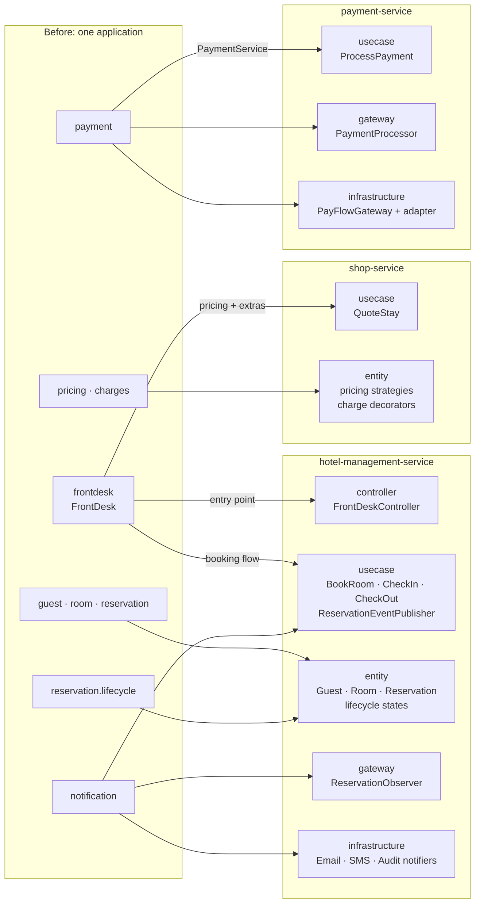
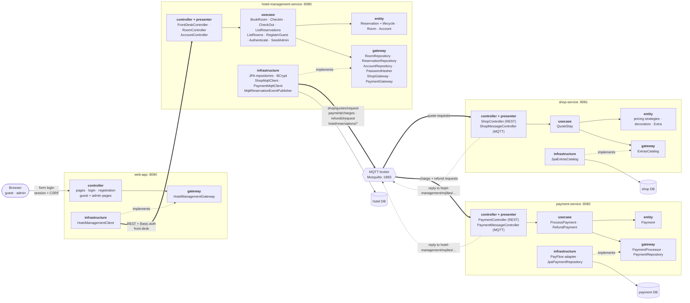
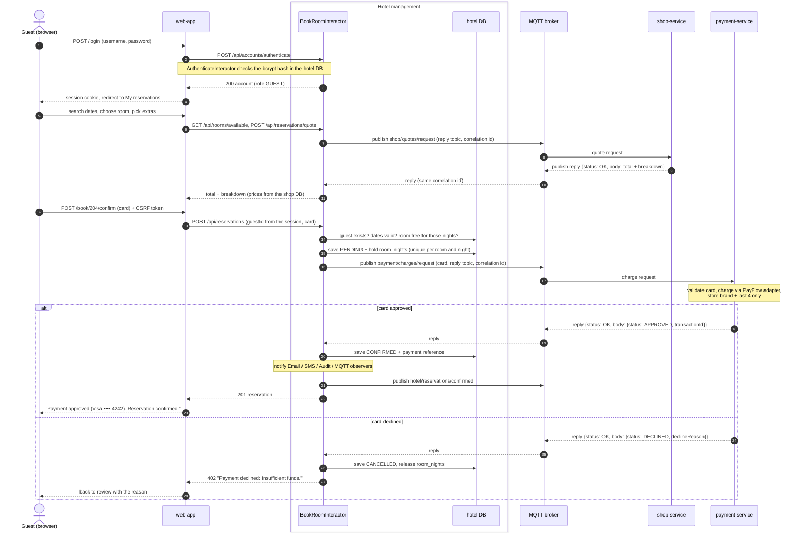
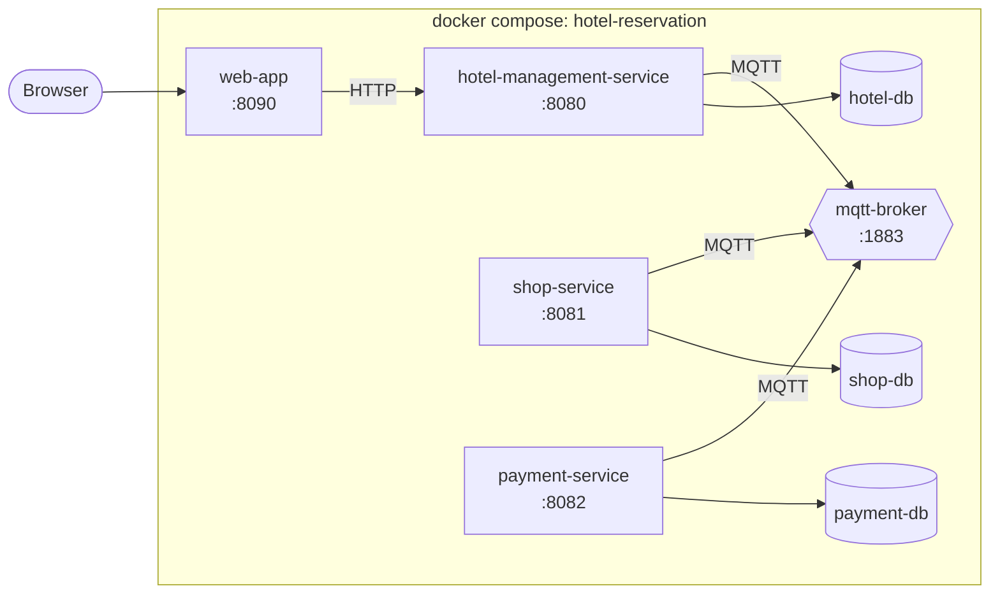

# Architecture: a web app in front of three Spring Boot services

The system is split by business purpose. A web app serves guests and administrators; behind it,
three services each own their business rules and their own PostgreSQL database. Each service is
its own Maven module, Spring Boot application and Docker container. The web app calls hotel
management over HTTP (REST, HTTP Basic auth). Hotel management talks to the shop and payment
services over **MQTT**, through a Mosquitto broker, using MQTT 5 request/response. Shop and
payment also keep their REST APIs for direct testing.

| Module | Business purpose | Entry point | Database |
|---|---|---|---|
| `web-app` | Guest and administration web interface | Thymeleaf pages on port 8090 | none |
| `hotel-management-service` | Rooms, guest and admin accounts, reservations and their lifecycle, notifications | `/api/reservations`, `/api/rooms`, `/api/accounts` | `hotel` |
| `shop-service` | Pricing strategies and the additional services price list | MQTT `shop/quotes/request`; `/api/shop/quotes` | `shop` |
| `payment-service` | Charging the guest and recording every payment | MQTT `payment/charges/request`, `payment/refunds/request`; `/api/payments` | `payment` |

Layers inside each service:

| Layer | Holds | May depend on |
|---|---|---|
| `controller` | REST endpoints and MQTT message handlers; creates a presenter per request and calls a use case | `usecase`, `model`, `presenter` |
| `presenter` | Implements the use case's output port; builds the JSON view model and the HTTP status (web presenters) or the reply status (message presenters) | `usecase`, `model` |
| `model` | Request/response records crossing the use case boundary | `entity` (only to build responses) |
| `usecase` | One interface per use case, its implementation (interactor), and its presenter interface (output port) | `entity`, `model`, `gateway` |
| `entity` | Core business objects and rules | nothing outside `entity` |
| `gateway` | Interfaces for what the use cases need from outside: repositories, other services, password hashing | `entity` |
| `infrastructure` | Gateway implementations: the database (JPA), the MQTT connection and clients, external SDKs, notifiers | `gateway`, `entity`, `model` |
| `config` | Spring wiring (composition root) and security | everything in the service |

`entity`, `model`, `gateway` and `usecase` contain no Spring, JPA or Jackson code. The web app
has no business rules, so it has no `usecase` layer: its controllers call a
`HotelManagementGateway` directly. Every rule here is enforced by the `ArchitectureTest` in each
module.

## 1. How the original code was split

Each package of the original single application went to one service; the old `FrontDesk`
was split between hotel management (orchestration) and the shop (pricing and extras).

## 2. Inside the services, and the database as a plugin

Solid arrows point in the direction of a dependency (inward, toward the entities). Dashed arrows
mean "implements". Each database sits behind a gateway interface: the use cases only know
`RoomRepository`, `ExtrasCatalog`, `PaymentRepository` and so on, and a JPA adapter in
`infrastructure` plugs PostgreSQL in. MQTT is plugged in the same way: the use cases only know
`ShopGateway` and `PaymentGateway`, and `ShopMqttClient` / `PaymentMqttClient` implement them.
On the other side, a message controller (`ShopMessageController`, `PaymentMessageController`)
calls the same use case as the REST controller, with a message presenter instead of a web
presenter. The thick arrows are the only calls between processes.

## 3. A guest books a room

If no reply arrives within 10 seconds, the request fails; for a charge, the reservation is
cancelled and its nights released, exactly as for a decline.

## 4. Messages between the services (MQTT)

| Topic | Publisher | Subscriber | Payload |
|---|---|---|---|
| `shop/quotes/request` | hotel management | shop (shared subscription `$share/shop-service/…`) | `{nightlyRate, nights, breakfast, spa, airportTransfer}` |
| `payment/charges/request` | hotel management | payment (`$share/payment-service/…`) | `{reservationId, amount, card}` |
| `payment/refunds/request` | hotel management | payment (`$share/payment-service/…`) | `{transactionId}` |
| `hotel-management/replies/{instance}` | shop, payment | the hotel management instance that asked | `{status, body, error}` |
| `hotel/reservations/{confirmed, cancelled, checked-in, checked-out}` | hotel management | any interested service | `{event, reservationId, guestId, roomNumber, checkIn, checkOut, totalPrice, state, occurredAt}` |

- **Request/response:** MQTT 5's response topic and correlation data properties. Each hotel
  management instance listens on its own reply topic and matches replies to waiting requests by
  correlation id (`MqttRequester`); late or unknown replies are dropped.
- **Reply status** replaces the HTTP status code: `OK`, `INVALID_REQUEST` (400), `NOT_FOUND`
  (404), `REJECTED` (409), `ERROR` (500). A declined card is an `OK` reply whose body says
  `DECLINED`, as with the REST API.
- **QoS 1** (at least once) for every message. Shared subscriptions mean several copies of shop
  or payment can run, and each request is handled by one of them.
- **Security:** no anonymous clients; one login per service from Docker secrets; the broker's ACL
  (`mqtt-broker/acl`) allows each login only the topics in the table above.
- **Same use cases, two entry points:** `ShopMessageController` and `PaymentMessageController`
  call the same use cases as the REST controllers, with a message presenter that builds the reply.
  The MQTT connection itself (`PahoMqttTransport`, Eclipse Paho) is infrastructure behind a small
  `MqttTransport` interface, so tests swap in an in-memory broker.

## 5. Deployment with Docker Compose

Only the web app is meant for people; the service APIs and the broker are published for
development. Databases are not published at all. Each container gets only the secrets it needs.

| Container | Secrets it receives |
|---|---|
| `web-app` | `hotel_api_password` (to call hotel management) |
| `hotel-management-service` | `hotel_api_password`, `hotel_db_password`, `admin_password`, `mqtt_hotel_password` |
| `shop-service` | `shop_api_password`, `shop_db_password`, `mqtt_shop_password` |
| `payment-service` | `payment_api_password`, `payment_db_password`, `mqtt_payment_password` |
| `mqtt-broker` | `mqtt_hotel_password`, `mqtt_shop_password`, `mqtt_payment_password` (hashed into its password file at startup) |
| `hotel-db` / `shop-db` / `payment-db` | its own `*_db_password` |

## Databases and consistency

Each service owns one database and no other service reads it:

| Database | Tables | Owner |
|---|---|---|
| `hotel` | `rooms`, `accounts`, `reservations`, `room_nights` | hotel management |
| `shop` | `extra_prices` | shop |
| `payment` | `payments` (brand and last four digits only, never full card numbers) | payment |

Schemas are created by Flyway migrations in each service (`src/main/resources/db/migration`).

No data is duplicated across databases, so there is nothing to keep in sync. Two flows touch two
databases, and both are ordered so that a failure at any step leaves each database valid:

- **Booking:** the reservation is saved as `PENDING` and holds its nights in the hotel database;
  then the payment service charges the card and records the payment. Approved → the reservation
  becomes `CONFIRMED` and keeps the payment reference. Declined (or no reply from the payment
  service in time) → the reservation becomes `CANCELLED` and releases its nights.
- **Cancellation:** the refund is made first; the reservation is saved as `CANCELLED` only after
  the payment service confirms it.

**No double bookings.** `room_nights` (room, night, reservation) has a primary key on
(room, night). The JPA adapter writes those rows in the same transaction as the reservation while
its state holds the room (pending, confirmed, checked in) and deletes them otherwise. A second
reservation for any of the same nights violates the key, the adapter reports
`RoomUnavailableException`, and the use case answers "already booked" — even when two bookings
pass the availability check at the same moment.

If more data ever has to be shared, the services would exchange events and accept eventual
consistency rather than share a database. The `hotel/reservations/*` events are the start of
that: any new service can subscribe to them without changing hotel management.

## Rules that keep the services independent

1. **Dependencies point inward.** `controller → usecase → entity`. Use cases reach the outside
   world, including their database, only through `gateway` interfaces, and send results out only
   through their presenter interface.
2. **The database is a plugin.** JPA entities and Spring Data repositories live in
   `infrastructure`; domain entities know nothing about persistence. The use-case tests run the
   same rules on in-memory gateways.
3. **One database per service, no shared code.** Each service is a separate module with its own
   schema; the hotel management clients keep their own copy of the shop and payment message
   shapes, and each service has its own small copy of the MQTT connection code.
4. **Every call is authenticated.** People log in to the web app; the web app calls hotel
   management with HTTP Basic credentials; services log in to the MQTT broker, which limits each
   to its own topics. All passwords are Docker secrets, never committed.
5. **`config` is the composition root.** It is the only place that knows every concrete class.

## Where every original class went

| Before | After |
|---|---|
| `frontdesk.FrontDesk` | Split: `FrontDeskController` + `BookRoom`, `CheckIn`, `CheckOut` use cases in hotel management; the pricing and extras part moved to the shop's `QuoteStayInteractor` |
| `guest.Guest`, `room.Room`, `room.RoomStatus`, `reservation.Reservation` | `hotelmanagement.entity` |
| `reservation.lifecycle.*` | `hotelmanagement.entity.lifecycle` |
| `room.RoomAvailabilityService` | Date-based availability: `Reservation.blocks(from, to)` with `ReservationState.holdsRoom()` |
| `room.RoomService` | Room status updates inside `CheckInInteractor` / `CheckOutInteractor` |
| `reservation.ReservationService` | Reservation numbers from a database sequence (`ReservationRepository.nextId()`) |
| `notification.ReservationObserver` | `hotelmanagement.gateway` |
| `notification.ReservationEventPublisher` | `hotelmanagement.usecase` |
| `notification.EmailNotifier`, `SmsNotifier`, `AuditLogObserver` | `hotelmanagement.infrastructure` |
| `pricing.*` | `shop.entity.pricing` |
| `charges.*` | `shop.entity.charges` (prices now come from the shop database) |
| `payment.PaymentProcessor` | `payment.gateway` |
| `payment.PayFlowGateway`, `PayFlowGatewayAdapter` | `payment.infrastructure` |
| `payment.PaymentService` | `payment.usecase.ProcessPaymentInteractor` |
